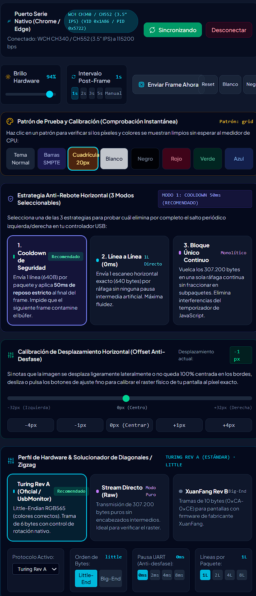
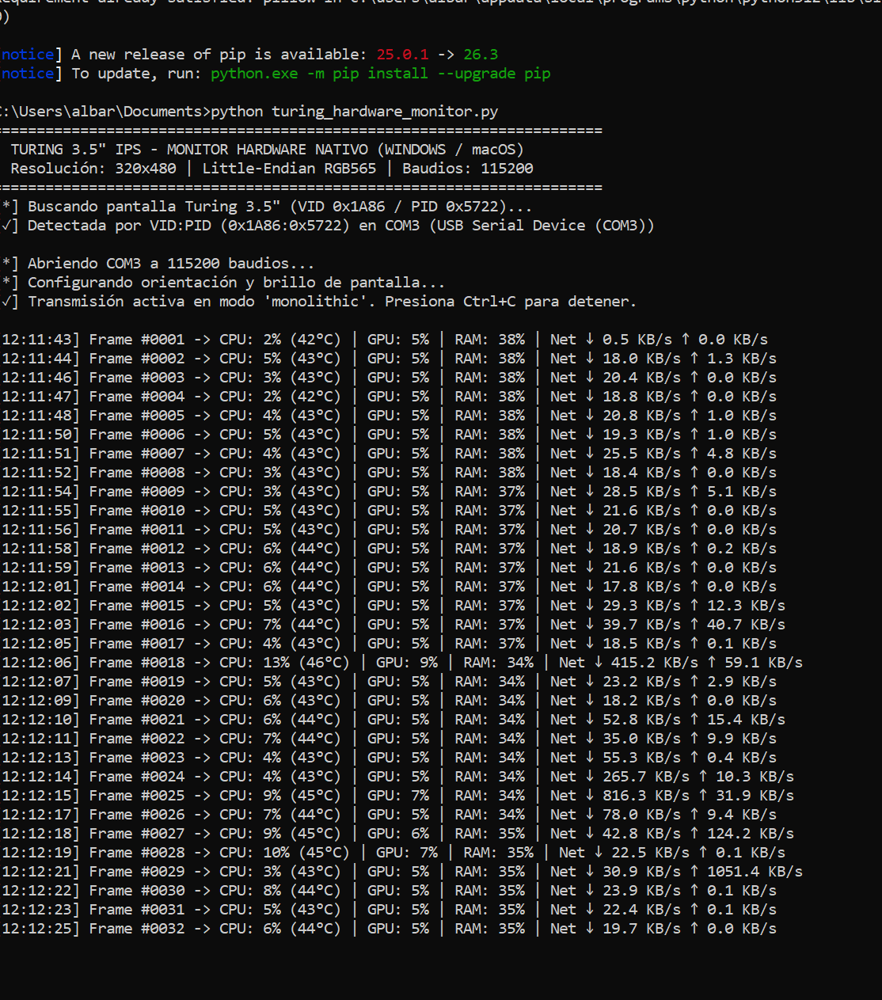

# Turing 3.5" IPS USB Smart Screen — Studio, Protocol & Python Monitors

<div align="center">

[](LICENSE)
[](https://www.python.org/)
[](https://www.typescriptlang.org/)
[](https://react.dev/)
[](https://developer.mozilla.org/en-US/docs/Web/API/Web_Serial_API)
[](https://github.com/)

**The definitive open-source studio, reverse-engineered protocol documentation, and zero-bloat native Python monitors for the Turing 3.5" IPS USB secondary screen (Turzx / XuanFang Rev A & B).**

[Features](#-key-features) • [Hardware Checklist](#-does-this-project-help-my-device) • [Critical Findings](#-research--critical-engineering-findings) • [Python Monitors](#-standalone-native-python-monitors-windows--macos) • [Protocol Reference](#-low-level-protocol-reference) • [GitHub Topics](#-github-topics--tags)

</div>

---

### ⭐ About This Project

> **Turing Screen Studio** is an all-in-one open-source engineering toolkit designed to liberate the popular **3.5" IPS USB Smart Screen** from clunky, closed-source proprietary software. It provides:
> 1. An in-browser **Web Serial Studio** to test, calibrate, and stream custom animated themes, Pomodoro timers, and retro HUDs directly from Chrome or Edge.
> 2. Standalone, lightweight **Python 3 hardware monitors** for Windows and macOS (both Landscape 480×320 and Portrait 320×480) with ~0.1% CPU overhead.
> 3. Exhaustive **protocol documentation** explaining every opcode, orientation packet, and the exact timing discipline required to eliminate the infamous "white screen" and "horizontal jump" bugs.

⭐ **If this repository helps you get your screen working or saved you hours of debugging, please give it a Star! It helps other developers find it.**

---

## 📸 Screenshots & Showcase

| Web Serial Calibration & Fine Tuning Studio | Standalone Native Python Hardware Monitor |
| :---: | :---: |
|  |  |
| *In-browser calibration, anti-drift selector & test patterns* | *Rock-solid 115200 bps telemetry streaming on Windows / macOS* |

---

## 🏷️ GitHub Topics & Tags

If you are maintaining or forking this repository, paste these tags into your GitHub **About** section for instant search discoverability:

```text
turing-smart-screen, turing-35, turzx, xuanfang, hardware-monitor, pc-stats, web-serial-api, ch340, ch552, rgb565, ili9488, st7796, python-monitor, pc-hardware-monitor, secondary-display, system-monitor, usb-serial
```

---

## 📌 Does This Project Help My Device?

Verify if your device matches this specification:

| Feature / Spec | Supported Hardware | Notes |
| :--- | :--- | :--- |
| **Physical Appearance** | 3.5-inch IPS display with metal backplate, **two USB Type-C ports** (bottom and side) | Includes a small acrylic or metal kickstand for vertical/horizontal desk positioning |
| **USB Hardware ID** | **VID `0x1A86`, PID `0x5722`** (or `0x1A86:0x7523`) | Manufactured with **WCH CH340** (USB-UART bridge) + **CH552** (8051 USB MCU) |
| **Official Firmware** | **Turing Smart Screen Rev A / Turzx** | Uses 6-byte bit-packed command headers and 16-byte orientation packets |
| **Clone Firmware** | **XuanFang 3.5" Revision B / Flagship** | Uses 10-byte framed packets (`0xCA`-`0xCE`), Big-Endian RGB565 (both supported!) |
| **Connection Type** | **USB Only (Serial COM port / CDC UART)** | ⚠️ **This is NOT an HDMI/DisplayPort graphics monitor.** It communicates purely via raw UART at 115200 bps. |

---

## 🔬 Research & Critical Engineering Findings

Getting this device to display frames smoothly without third-party proprietary bloatware (such as the default Chinese *3.5inchENG* software which consumes up to 10% CPU and triggers antivirus false positives) required reverse-engineering several undocumented hardware behaviors:

### 1. The "White Screen" Standby State
- **Symptom:** The display powers up with a blank white screen, and standard bitmap packets are completely ignored.
- **Root Cause:** The internal display controller (**ST7796** or **ILI9488**) initializes in low-power standby mode with the backlight turned on (producing a pure white raster).
- **Solution:** Before transmitting bitmaps, the host must send the official waking handshake probe:
  1. Six consecutive `HELLO` bytes: `[69, 69, 69, 69, 69, 69]` (`0x45`).
  2. Wait 40–80 ms.
  3. Send opcode `109` (`SCREEN_ON`): `[0, 0, 0, 0, 0, 109]`.
  4. Send the 16-byte orientation packet (`opcode 121`).

### 2. The Win32 `WriteFile` Buffer Overrun (Why monolithic writes fail on Windows)
- **Symptom:** In Python (`pyserial`) on Windows, sending a full 307,206-byte buffer in a single `ser.write()` causes the screen to stay white indefinitely.
- **Root Cause:** With a finite `write_timeout` (e.g. 2.0s), the Windows COM driver aborts the write operation after only ~8–16 KB are written. Since the CH552 MCU expects exactly 307,200 pixel bytes following the `DISPLAY_BITMAP` command, it hangs waiting for the rest of the frame.
- **Solution:** 
  1. Set `write_timeout=None` when opening the serial port in Python.
  2. Adopt the **1L Scanline Discipline** (see below).

### 3. The Periodic Lateral Drift & Zigzag Artifacts
- **Symptom:** Every few seconds, the image shifts 1 pixel left or right, or shows diagonal tearing.
- **Root Cause:** The CH552 MCU has a 64-byte USB endpoint buffer. If the 6-byte command header is glued together with pixel bytes in one giant asynchronous write, or if chunks do not align with physical scanlines, the MCU circular FIFO drops bytes. Dropping just **2 bytes** (1 pixel) causes every subsequent scanline to draw shifted by 1 pixel.
- **The 1L Scanline Discipline:**
  - Send the 6-byte `DISPLAY_BITMAP` header separately.
  - Stream the framebuffer in exact **1-scanline chunks (`1L`)**:
    - **Portrait (320 × 480):** Exactly **640 bytes** per packet ($320 \times 2$).
    - **Landscape (480 × 320):** Exactly **960 bytes** per packet ($480 \times 2$).
  - This eliminates buffer congestion and provides 100% rock-solid, jitter-free rendering.

### 4. Color Packing: Little-Endian vs Big-Endian RGB565
- **Turing Rev A (Official):** **Little-Endian RGB565** (LSB first, MSB second).
  ```python
  rgb = ((r & 0xF8) << 8) | ((g & 0xFC) << 3) | (b >> 3)
  byte_lsb = rgb & 0xFF
  byte_msb = (rgb >> 8) & 0xFF
  ```
- **XuanFang Rev B (Clones):** **Big-Endian RGB565** (MSB first, LSB second).

### 5. Physical Wiring Safety
- The unit has **two USB Type-C ports**:
  - **Bottom Port:** Use when placed vertically (Portrait).
  - **Side Port:** Use when placed horizontally (Landscape) on the desk stand.
  - ⚠️ **DANGER:** **Never plug cables into both ports simultaneously!** The internal power rails are directly bridged and can damage host USB controllers.

---

## 🖥️ Web Serial Studio Features

1. **Direct USB Connection:** Connects directly via Google Chrome or Microsoft Edge using the native Web Serial API at 115200 bps (with 128 KB software FIFO buffering).
2. **Anti-Drift Strategy Selector:** Switch on-the-fly between:
   - **Mode 1 (Cooldown 50ms):** 1L scanlines with frame-boundary settling guard.
   - **Mode 2 (1L Direct):** 0ms scanline-by-scanline direct burst (fastest frame pacing).
   - **Mode 3 (Unified Monolithic):** Full continuous 307.2KB stream for raw controllers.
3. **Hardware Offset Calibrator (-32px to +32px):** Fine-tune raster phase shifts to align pixels to the exact display edges.
4. **Hardware Profiles:** 1-click toggling between *Turing Rev A* (Little-Endian) and *XuanFang Rev B* (Big-Endian).
5. **Instant Test Patterns:** SMPTE Color Bars, 20px Calibration Grid, Pure White, Pure Black, Red, Green, Blue.
6. **Live Hardware Monitor HUD:** Browser canvas HUD mirroring CPU, memory, clock, disk, and network metrics.
7. **9 Interactive Themes:** Cyberpunk HUD, Minimal Swiss Desk, Retro Pixel, Weather Station, Media Player, Crypto Ticker, Pomodoro Timer, Custom Image Frame, and Status Sign.

---

## 🐍 Standalone Native Python Monitors (Windows / macOS)

For permanent 24/7 background operation, we provide dedicated standalone Python scripts that read live system metrics via `psutil` and stream directly to the screen with ~0.1% CPU utilization:

### Available Scripts in `/public`:

| Script File | Target Orientation | Features |
| :--- | :--- | :--- |
| **`turing_hardware_monitor_landscape.py`** | **Horizontal (480 × 320)** | 3 Arc Meters (CPU %, GPU %, RAM %), live Network I/O box ($\downarrow / \uparrow$), Disk C: progress bar, digital clock, 960-byte 1L packets. |
| **`turing_hardware_monitor.py`** | **Vertical (320 × 480)** | Vertical Cyberpunk HUD, compact arc & bar meters, temperature monitors, 640-byte 1L packets. |
| **`turing_bridge.py`** | **Local HTTP Bridge** | Micro HTTP server (port 8989) allowing any browser tab to stream frames to the screen without iframe permissions restrictions. |

### Quick Start (Python):
```bash
# 1. Install dependencies
pip install pyserial psutil pillow

# 2. Run the Horizontal monitor (Landscape 480x320)
python public/turing_hardware_monitor_landscape.py

# Or run the Vertical monitor (Portrait 320x480)
python public/turing_hardware_monitor.py
```
*The script automatically probes all COM / `/dev/cu.wchusbserial*` ports matching VID `0x1A86` / PID `0x5722` and establishes synchronization.*

---

## 📋 Low-Level Protocol Reference

For complete opcode tables, bit-packed math formulas, and orientation packet structures, consult the dedicated specification file:

👉 **[TURING_35_HARDWARE_PROTOCOL.md](TURING_35_HARDWARE_PROTOCOL.md)**

### Opcode Quick Sheet (Turing Rev A):
- **`69` (`0x45`) - HELLO:** 6-byte wake-up handshake: `[69, 69, 69, 69, 69, 69]`.
- **`109` (`0x6D`) - SCREEN_ON:** Activates LCD video output: `[0, 0, 0, 0, 0, 109]`.
- **`108` (`0x6C`) - SCREEN_OFF:** Powers down the display panel.
- **`110` (`0x6E`) - SET_BRIGHTNESS:** Inverted scale: `0` = 100% brightness, `255` = backlight off.
- **`121` (`0x79`) - SET_ORIENTATION:** 16-byte packet (`orientation=0` for 320x480, `orientation=2` for 480x320).
- **`197` (`0xC5`) - DISPLAY_BITMAP:** 6-byte bit-packed bounding box header followed by pixel stream.

---

## 📚 Sources & Acknowledgments

This implementation was made possible by studying and cross-verifying the following community reverse-engineering projects and firmware documentation:

1. **[mathoudebine/turing-smart-screen-python](https://github.com/mathoudebine/turing-smart-screen-python):** Foundational reverse engineering of the Turing 3.5" USB protocol and revision detection.
2. **gerph & stalskol:** Initial packet capture analysis and bit-packed coordinate decoding for Turing Revision A.
3. **Turzx Official Community:** Hardware revision pinouts, orientation opcodes, and LCD controller initialization timings.
4. **XuanFang Open Community:** Reverse-engineering of the 10-byte framed protocol for Revision B clones.

---

## 🛠️ Running the Web Studio Locally

```bash
# Clone the repository
git clone https://github.com/your-username/turing-smart-screen-studio.git
cd turing-smart-screen-studio

# Install dependencies
npm install

# Start Vite development server
npm run dev
```

Open `http://localhost:3000` in Google Chrome or Microsoft Edge to connect to the screen.

---

## 📄 License

This project is licensed under the **MIT License** — feel free to use, modify, and distribute it in your own commercial or open-source projects.
